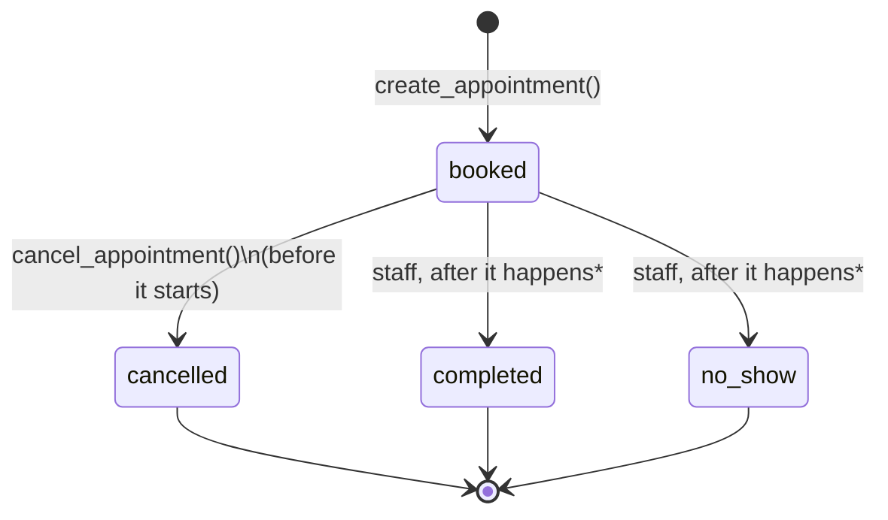

# Appointment Backend: Lifecycle and Validation Rules

How CareVoice stores, books, and cancels appointments, and every rule that protects them.
Code: `app/models.py` (tables), `alembic/versions/` (migrations), `app/appointments.py` (booking service).
Tests: `tests/test_appointments.py`. All data is synthetic (see "Synthetic data only").

## Running it

```powershell
docker compose up -d                 # start PostgreSQL 16 (data kept in the "pgdata" volume)
uv run alembic upgrade head          # create or upgrade the tables
uv run python seed.py                # load data/synthetic/ (safe to re-run)
uv run pytest tests/test_appointments.py   # uses a separate, freshly built test database
```

To start over: `docker compose down -v`, then the three commands above.

## Tables

| Table | One row per | Key rules |
|---|---|---|
| `departments` | Department (Family Medicine, ...) | Unique name |
| `appointment_types` | Appointment type per department, with its length | Length 5-240 minutes |
| `doctors` | Doctor | Must belong to an existing department |
| `doctor_schedules` | Weekly working period (e.g. Monday 08:00-15:00) | Ends after it starts; valid weekday |
| `patients` | Synthetic patient | Synthetic contact details only; can't be their own guardian |
| `appointments` | Appointment | See below |

All of it is created by migration `0001`, and loaded from `data/synthetic/` by `seed.py`.

## Lifecycle



| Status | Meaning | Blocks the time slot? |
|---|---|---|
| `booked` | Scheduled and not yet happened | **Yes** |
| `cancelled` | Cancelled by the patient or guardian; `cancelled_at` records when | No: the slot is free again |
| `completed` | The appointment took place | No (it's in the past) |
| `no_show` | The patient didn't attend and didn't cancel | No (it's in the past) |

- Only `booked` appointments can change status. Cancelling a cancelled, completed, or no-show appointment is
  refused (`invalid_transition`).
- An appointment that has already started can't be cancelled.
- \* Marking appointments `completed` or `no_show` is a **staff** action. It needs a staff identity, which
  doesn't exist yet, so it isn't implemented in the service. Seed data includes examples of both.
- Appointments are never deleted. Cancelling keeps the record (and when it happened).

## Who may do what: a patient ID alone is never enough

Patient IDs (`P-1001`, `P-1002`, ...) follow a simple pattern and are easy to guess, so **knowing one proves
nothing**.

1. Every service function needs an **`Actor`**: the verified person making the request.
2. An `Actor` can only be created by **`authenticate(patient_id, date_of_birth)`**. Code can't build one
   directly (that raises an error).
3. A failed login gives the **same message** whether the patient ID exists or not, so IDs can't be discovered
   by trial.
4. An actor may act for **themselves**, or for a patient whose **guardian** they are, but only while that
   patient is **under 18**.
5. Someone else's appointment is reported as **not found**, never as "not yours", so its existence isn't
   confirmed.
6. `booked_by_patient_id` records who actually made each booking (e.g. a guardian).

Patient ID plus date of birth is a weak check (birthdays aren't secret). It's a placeholder: Phase 5 adds a
proper authenticated session, and the `Actor` design means the rest of the code doesn't change.

## Validation rules

**Database** rules are enforced by PostgreSQL for every write, from any code, even under simultaneous requests.
**Service** rules are checked by `create_appointment()` / `cancel_appointment()` in `app/appointments.py`.

| Rule | Where | If broken | Tested by |
|---|---|---|---|
| No two **booked** appointments for the same doctor overlap in time | **Database** (exclusion constraint `no_double_booking_doctor`) | `slot_unavailable` | overlap, partial-overlap, direct-insert, and 20-simultaneous-requests tests |
| A patient can't be in two booked appointments at once | **Database** (`no_overlapping_patient_appointments`) | `slot_unavailable` | `test_a_patient_cannot_be_in_two_appointments_at_once` |
| Back-to-back appointments are allowed (09:00-09:30 then 09:30) | **Database** (time ranges include their start, not their end) | | `test_back_to_back_appointments_are_allowed` |
| Cancelled appointments don't block their slot | **Database** (constraints only apply `WHERE status = 'booked'`) | | `test_a_cancelled_appointment_does_not_block_its_slot` |
| The doctor exists and works in the appointment's department | **Database** (`fk_doctor_in_department`); the service checks existence first | `doctor_not_found` | nonexistent and wrong-department tests |
| The appointment type exists in the department, and the **duration is that type's duration** | **Database** (`fk_type_and_duration`); the service checks the type first | `invalid_appointment_type` | type and duration tests |
| End time = start + duration | **Database** (`end_matches_duration`) | | `test_the_database_rejects_an_end_time_...` |
| Appointment types are 5-240 minutes | **Database** (`duration_is_realistic`) | | `test_the_database_rejects_unrealistic_appointment_lengths` |
| Valid status and mode values; `cancelled_at` set exactly when cancelled | **Database** (`CHECK`s) | | `test_the_database_requires_a_cancellation_time_...` |
| Only synthetic contact details | **Database** (`synthetic_phone_only`, `synthetic_email_only`) | | synthetic-data tests |
| The actor is the patient, or their guardian while under 18 | Service | `not_authorized` / `appointment_not_found` | authorization tests |
| The appointment fits **inside one of the doctor's shifts** (start and end) | Service | `outside_schedule` | shift tests |
| Appointments start on the **15-minute grid**: :00, :15, :30, :45 (`slot_interval_minutes`) | Service | `invalid_time` | `test_appointments_start_on_the_slot_grid` |
| Not in the past, and at most **90 days** ahead (`booking_window_days`) | Service | `invalid_time` | `test_no_booking_in_the_past_or_too_far_ahead` |
| Telehealth only in departments that offer it | Service | `telehealth_not_available` | `test_telehealth_only_where_...` |
| `new_patient` appointments only with doctors accepting new patients | Service | `not_accepting_new_patients` | `test_new_patients_cannot_book_...` |
| At most **3** upcoming booked appointments per patient (`max_appointments_booked_per_patient`) | Service, with the patient's row **locked** so simultaneous bookings take turns | `booking_limit_reached` | `test_a_patient_can_have_at_most_three_...` |
| The same request sent twice books once (**idempotency key**) | Service returns the first booking; **database** `UNIQUE` as a backstop | | `test_the_same_request_twice_books_only_once` |
| Cancelling less than **24 hours** ahead costs **$25** (`cancellation_notice_hours`, `late_cancellation_fee_usd`) | Service | (returns the fee) | cancellation tests |

The numbers (90 days, 3 appointments, 24 hours, $25) come from `clinic.json`, so policy changes need no code
changes. `clinic.json` itself is validated when it's loaded (`app/clinic.py`, `tests/test_clinic_validation.py`).

## Availability (free slots)

`get_doctor_availability(session, doctor_id=..., appointment_type=..., day=..., now=...)` returns the free
start times for one doctor, one appointment type, and one day. `find_next_available(...)` returns the next
few free times across the coming days (default: 5 slots, up to 14 days ahead).

A start time is offered when **all** of these hold, which are exactly the checks booking uses, so every
offered slot can be booked (tested by `test_every_offered_slot_can_actually_be_booked`):
- it's on the 15-minute grid;
- the whole appointment (start + the type's duration) fits inside one of the doctor's shifts;
- it's after `now` and at most 90 days ahead;
- it doesn't overlap any of the doctor's **booked** appointments (cancelled ones don't count).

Example: Dr. Raj Patel, follow-up (20 minutes), Friday 2026-10-30, shift 08:00-15:00. A-0005 occupies
08:00-08:20, so 08:00 and 08:15 aren't offered. The first slot is 08:30, the last is 14:30
(ends 14:50; 14:45 would end after the shift).

Availability needs no `Actor`: it returns only free times, never who is booked or why a time is taken.
Its rules don't consider the *patient's* own diary (their limit or their other appointments); booking
still checks those, so a free slot can still be refused for a particular patient.

### Availability in the chat (read-only)

When a chat message asks about a doctor (or a department) and a time, `app/availability_lookup.py` attaches
the real free times to the message, inside `<availability_lookup>` tags, and the model words them.
It understands everyday wording: "Monday", "next Tuesday", "tomorrow", "October 30", "10/30"; "8am",
"8:30", "9.30", "829 AM" and "8 30" (speech-to-text), "8 to 9", "8-9". If a message names no doctor or day
("Book an appointment for 8 to 8 30"), they're taken from the user's recent earlier messages.

It **never books anything**. Every availability fact ends with "NOTHING has been booked", and the prompt
forbids saying or suggesting that an appointment is booked. If the booking database is down, the chat keeps
working without availability facts. `CAREVOICE_NOW` fixes "now" for tests and evaluations.

## Times and time zones

- Data files give **hospital local times** (America/Los_Angeles), e.g. `2026-11-02T10:00`.
- The database stores **time-zone-aware timestamps**, so daylight saving is handled: 10:00 on Oct 27 is
  17:00 UTC, while 10:00 on Nov 2 (after the clocks change) is 18:00 UTC.
- Shifts are checked in hospital local time.
- Service functions take `now` as a parameter rather than reading the clock, so tests can fix the date
  (the seed data's reference moment is Tuesday 2026-10-20, 12:00).

## Why the database enforces the key rules

The service checks rules one request at a time. Two requests that arrive at the same moment can both pass
every check before either has saved its booking. We measured this: with the exclusion constraint removed,
20 simultaneous requests put **15 patients into one 09:00 slot**. With it, exactly 1 succeeds, every time.

## Synthetic data only

- `patients.phone` must be in the `555-0100` to `555-0199` range (reserved for fiction in the US), and
  `patients.email` must end in `@example.com` (reserved for examples).
- PostgreSQL rejects anything else, so real patient data can't be stored by accident.
- Remove these constraints only in a separate, reviewed migration, together with real authentication,
  encryption, and access auditing.

## Not yet covered

| Gap | Why it matters | When |
|---|---|---|
| The assistant can show free times but can't book | Users still call to book | Phases 5-6: tools, identity check, confirmation |
| "between 10 and 11" only reads the 10 | A bare number after "and" is too often not a time ("2 kids and 3 questions") | If needed |
| Referrals aren't verified (Cardiology new patients, Radiology, HMO) | There's no referral data | When referral data exists |
| Staff actions (`completed`, `no_show`) | Needs a staff identity | Phase 5+ |
| Audit log of who changed what | Required for real healthcare systems | Phase 9 |
| Stronger authentication than date of birth | Birthdays aren't secret | Phase 5 |
